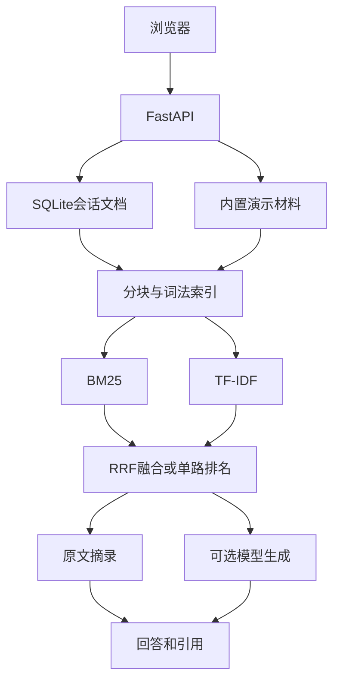

# 架构与接口

浏览器同源调用FastAPI，服务端读取内置JSON与当前会话SQLite文档，进行分块和检索。



| 方法 | 路径 | 用途 |
|---|---|---|
| GET | /health | 健康检查 |
| GET | /api/documents | 当前会话文档列表和模型可用状态 |
| GET | /api/documents/{id} | 读取有权访问的完整原文 |
| POST | /api/documents | 上传JSON形式的title/text |
| DELETE | /api/documents | 删除当前会话的所有自定义文档 |
| POST | /api/query | question、method、use_llm |

查询示例：

```json
{"question":"Macro-F1是什么？","method":"hybrid","use_llm":false}
```

前端只使用textContent展示文档与回答，不执行上传文本里的HTML。模型输入将文档标记为非可信材料，但提示词防御不等于彻底防住提示注入。模型调用不提供工具或外部操作权限。会话ID是随机生成的256位Cookie，不使用用户输入的文件名作为路径。模型访问口令只授权生成接口，不是完整用户管理系统。

默认最多5份自定义文档/会话、全库最多1000份；单文件最多50000字符；请求体最多350000字节；单进程全局60次写请求/分钟；最多2路并发模型请求。全局限流是演示保护，会互相影响访客，生产需按身份分配额度并使用共享存储。
